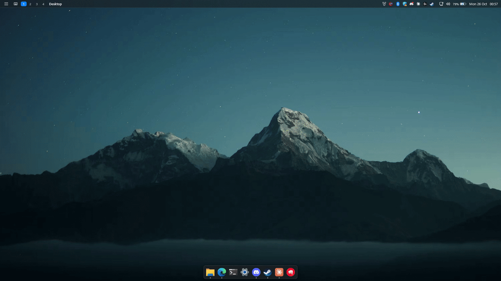
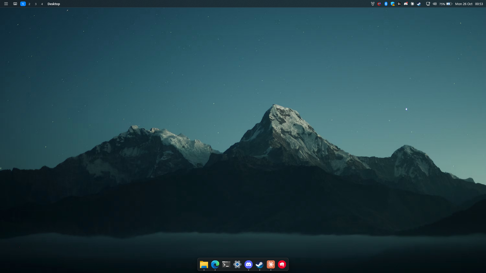
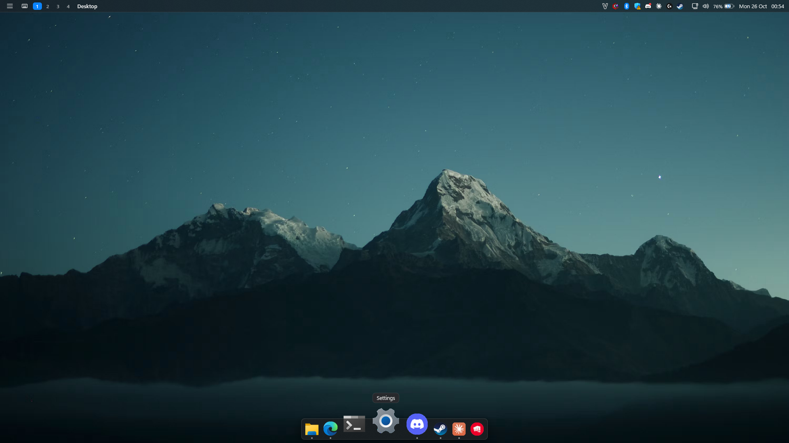
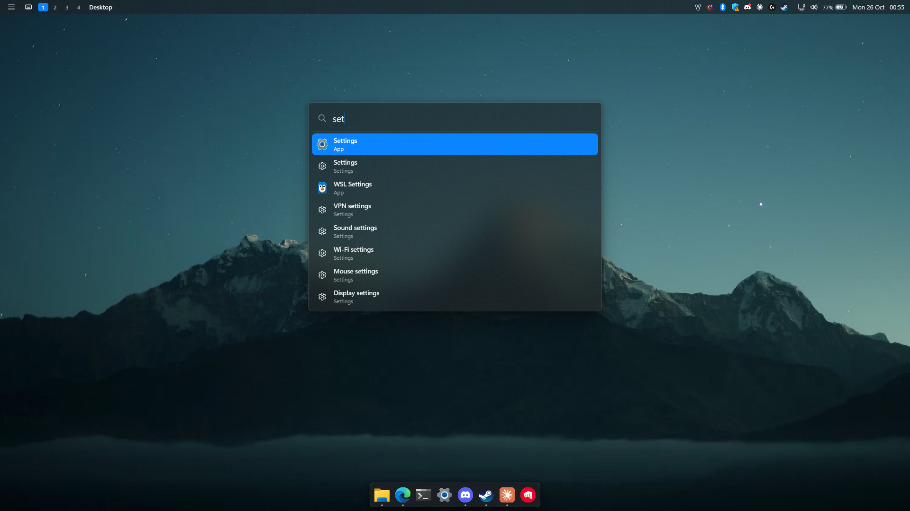
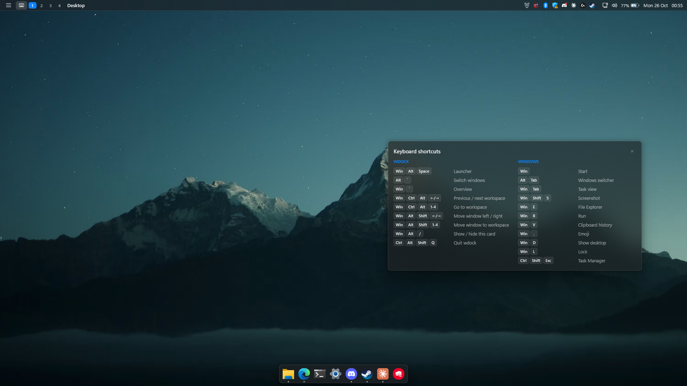
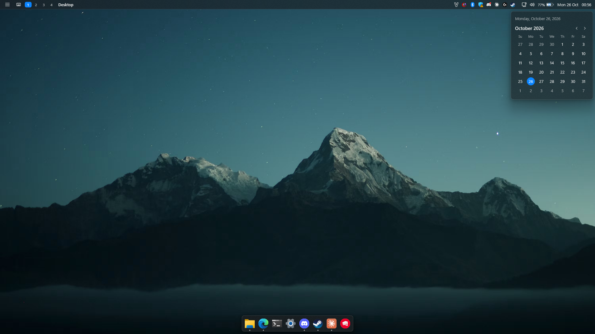
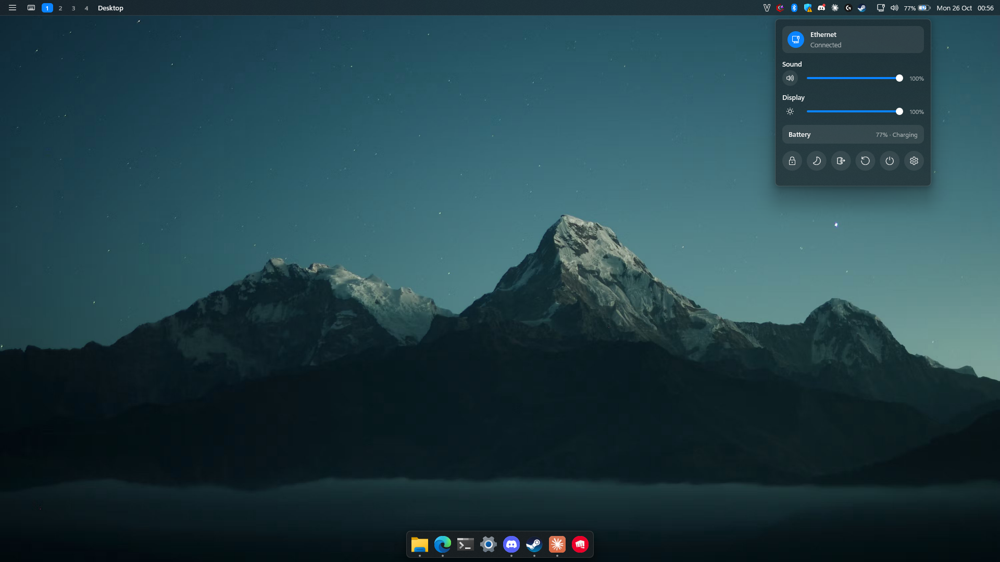

# wdock

**English** · [Tiếng Việt](README.vi.md)

wdock is a macOS-style top bar and dock for Windows 11, written in Rust.

- Resource targets: under 25 MB of RAM, close to 0% CPU when idle, and 0% while a game is running.
- It never injects code into other processes and does not use keyboard hooks, so it is safe alongside anti-cheat software.

[](docs/media/demo.mp4)

*The demo covers the dock's magnification, the launcher, the shortcut card, the calendar and quick settings. Click it for the 1080p MP4.*

## Screenshots

All screenshots are 1920×1080.

| | |
|---|---|
|  |  |
| Top bar and dock | Dock magnification and labels |
|  |  |
| Launcher (Win+Alt+Space) | Shortcut card (Win+Alt+/) |
|  |  |
| Calendar | Quick settings: network, volume, brightness, battery, power |

## Features

- **Top bar:**
  - Launcher button and shortcut-card button.
  - Workspace pills (4 workspaces by default).
  - Title of the active window.
  - System tray hosted by wdock itself.
  - Volume, network and battery indicators that open quick settings.
  - Clock that opens a calendar.
- **Dock:**
  - Pinned and running apps with running-indicator dots.
  - macOS-style magnification and labels.
  - Live window previews.
  - Drag to reorder and a right-click menu.
  - Smart auto-hide.
- **Launcher:** fuzzy search over installed apps (Win32 and Store) and Settings pages.
- **Window management:** window switcher (Alt+\`), overview (Win+\`) and virtual workspaces.
- **Game mode:** when a full-screen app (a game, or F11 in a browser) is in front, the bars on that monitor stop drawing and stop running timers. wdock also stops following window movement inside the game.

## How it works (hybrid mode)

Explorer stays the Windows shell, and wdock runs alongside it:

- **Explorer's taskbar:**
  - It is hidden with auto-hide plus SW_HIDE.
  - Its original state is saved to `%LOCALAPPDATA%\wdock\taskbar.txt` and restored when wdock exits.
- **Top bar:** it registers as an AppBar, so maximized windows never sit under it.
- **Dock:** in smart mode (the default) it slides away when a window overlaps it and comes back when the pointer reaches the bottom edge.
- **Tray:** wdock hosts the system tray. AppBar messages it does not handle are forwarded to explorer.
- **Windows shortcuts:** Win+Shift+S, PrtScn, Win+X, `ms-settings:` links and Windows' other shortcuts keep working.

## Installation

Building needs the [Rust toolchain](https://rustup.rs) (stable, edition 2024). Installing does not need admin rights.

```bash
powershell -ExecutionPolicy Bypass -File scripts\install.ps1
```

The script:

1. Builds the release binary.
2. Copies it to `%LOCALAPPDATA%\Programs\wdock\wdock.exe`.
3. Adds `HKCU\...\Run\wdock = "<exe>" --guard`, so wdock starts at every sign-in.
4. Starts wdock immediately.

Options:

- `-NoBuild` uses the existing `target\release` build.
- `-NoStart` installs without starting wdock.

Quit wdock before installing over a running copy.

The `--guard` process runs the shell as a `--shell` child:

- If the shell crashes, the guard restarts it after about 1 second.
- After 3 crashes within 60 seconds, the guard gives up and restores explorer's taskbar.

## Keyboard shortcuts

All shortcuts use `RegisterHotKey` with combinations explorer does not already use. Win+Alt+/ or the keyboard button in the top bar shows them all.

| Keys | Action |
|---|---|
| Win+Alt+Space (also Ctrl+Alt+Space if it is free) | Launcher |
| Alt+\` / Alt+Shift+\` | Window switcher |
| Win+\` | Overview of all windows |
| Win+Ctrl+Alt+← / → / 1–9 | Switch workspace |
| Win+Alt+Shift+← / → / 1–9 | Move the active window to another workspace |
| Win+Alt+/ | Show or hide the shortcut card (draggable, remembers its position) |
| Ctrl+Alt+Shift+Q | Quit wdock and bring explorer's taskbar back |

## Configuration

- The configuration file is `%APPDATA%\wdock\config.toml`. wdock creates it from a commented template on first run.
- Save the file as UTF-8 without a BOM.
- Changes apply after a restart: press Ctrl+Alt+Shift+Q, then run `wdock.exe --guard`, or sign out and back in.
- Sections: `[appearance]`, `[topbar]`, `[tray]`, `[dock]`, `[workspaces]`, `[switcher]`, `[performance]`.
- In `[dock]`:
  - `icon_size` defaults to 32.
  - `magnification` defaults to 2.0.
  - `auto_hide` is `"smart"`, `"on"` or `"off"`. With `"off"`, the dock reserves a fixed strip at the bottom of the screen.

Data and logs live in `%LOCALAPPDATA%\wdock\`:

- `logs\wdock.log` and `logs\wdock-guard.log`
- `pinned.txt` (pinned apps)
- `hidden.txt` (windows parked in other workspaces)
- `taskbar.txt`
- `shortcuts.txt`

## Uninstalling and recovery

To uninstall:

```bash
powershell -ExecutionPolicy Bypass -File scripts\uninstall.ps1
```

The script:

1. Removes the sign-in entry.
2. Stops the guard, then the shell.
3. Restores explorer's taskbar and any windows parked in other workspaces.

Options:

- `-RemoveFiles` also deletes the installed binary.
- `-RemoveData` also deletes logs, caches and state.

Your configuration is kept either way.

If wdock was killed and explorer's taskbar did not come back, run:

```bash
"%LOCALAPPDATA%\Programs\wdock\wdock.exe" --restore-taskbar
```

wdock also restores the taskbar on shutdown and sign-out (WM_QUERYENDSESSION).

## Development

- `cargo run --release -- --dev` runs wdock under a development supervisor that restarts it on crashes and logs to `wdock-dev.log`.
- `cargo test --release` runs the unit tests.
- `cargo clippy --release` reports no warnings.

Command-line modes:

| Argument | Mode |
|---|---|
| none or `--shell` | the shell |
| `--guard` | the sign-in supervisor |
| `--dev` | the development supervisor |
| `--restore-taskbar` | restore explorer's taskbar and exit |

The source is in `crates/wdock/src`:

- `app.rs`: message loop, shortcuts and game mode.
- `ui/`: Direct2D bars and popups.
- `platform/`: Win32 wrappers, the tray host and the AppBar.
- `services/`: audio, network, power, brightness and app index.
- `model/`: configuration, windows, tray and search.

## Measurements

Measured on Windows 11 with two 1080p monitors, release build.

| Item | Result |
|---|---|
| Private working set (shell / guard) | ~13–21 MB / ~1.2 MB |
| Idle CPU | 15–47 ms per 60 s (under 0.1%) |
| CPU with a full-screen app in front | 0 ms over 20 s |
| Full-screen (F11) detection | ~15 ms |
| Leaks (200 shortcut-card toggles + 20 launcher cycles) | handles stable at ~614, GDI 40–43, memory plateaus at ~32 MB private bytes |
| Shell crash | the guard restarts it in ~1 s; all tray icons return and the taskbar stays hidden |

## License

MIT
