# wdock

[English](README.md) · **Tiếng Việt**

wdock là bộ top bar, dock và Dynamic Island kiểu macOS cho Windows 11, viết bằng Rust.

- Mục tiêu tài nguyên: RAM dưới 25 MB, CPU gần 0% khi rảnh, 0% khi đang chơi game.
- Không inject code vào tiến trình khác, không dùng keyboard hook, không tự gọi mạng (bridge lời bài hát tùy chọn chỉ lắng nghe trên `127.0.0.1`), nên an toàn khi chạy cùng anti-cheat.
- Chạy song song với explorer chứ không thay thế nó. Các tính năng của Windows vẫn hoạt động, và thoát wdock thì taskbar bình thường quay lại.

[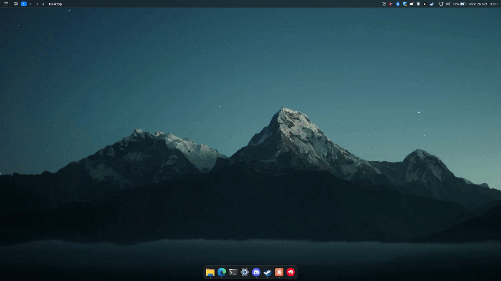](docs/media/demo.mp4)

*Video demo gồm dock phóng to, launcher, icon khay, lịch và Quick Settings. Bấm vào để xem bản MP4 1080p.*

[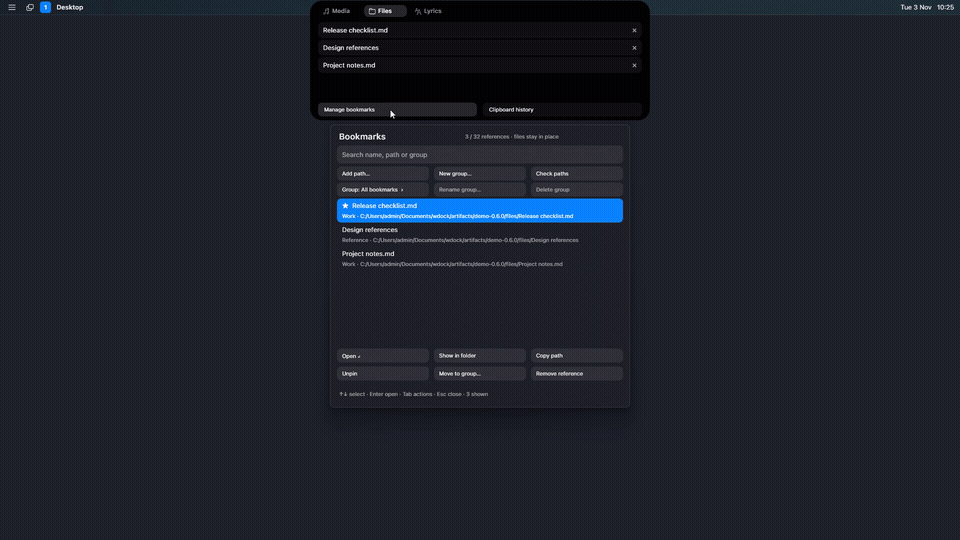](docs/media/bookmarks-clipboard.mp4)

*Bookmark, nhóm file, tìm kiếm và clipboard text chỉ lưu trong RAM của wdock 0.6.0. Quay trực tiếp từ ứng dụng với dữ liệu mẫu; bấm để xem video 1080p.*

## Mục lục

- [Ảnh chụp màn hình](#ảnh-chụp-màn-hình)
- [Tính năng](#tính-năng)
- [Cách hoạt động](#cách-hoạt-động)
- [Cài đặt](#cài-đặt)
- [Phím tắt](#phím-tắt)
- [Cấu hình](#cấu-hình)
- [Xử lý sự cố](#xử-lý-sự-cố)
- [Gỡ cài đặt](#gỡ-cài-đặt)
- [Phát triển](#phát-triển)
- [Kết quả đo](#kết-quả-đo)

## Ảnh chụp màn hình

Tất cả ảnh có độ phân giải 1920×1080.

| | |
|---|---|
| 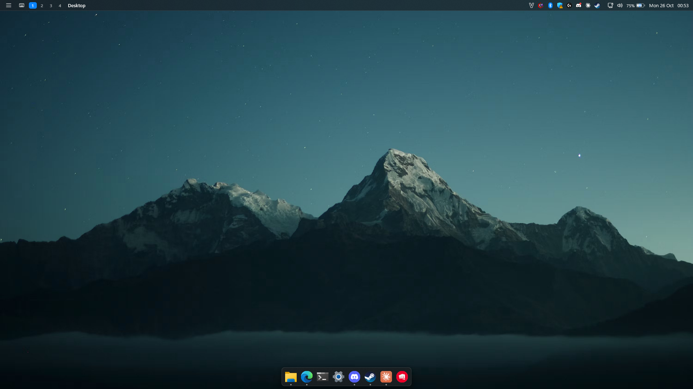 | 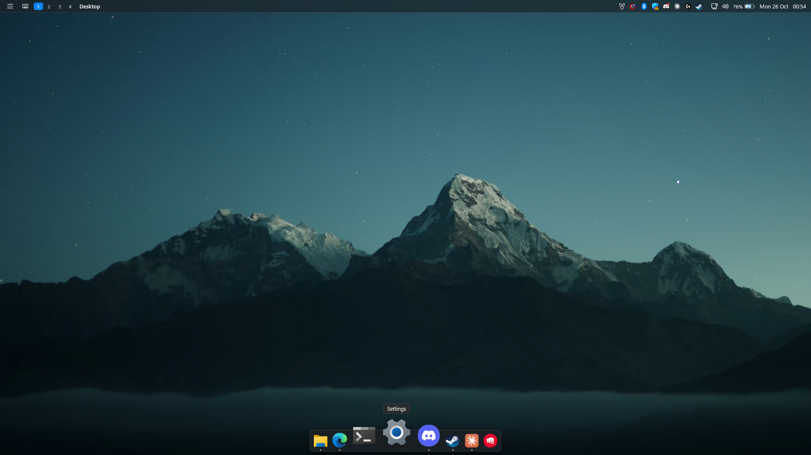 |
| Top bar và dock | Dock phóng to kèm nhãn tên |
| 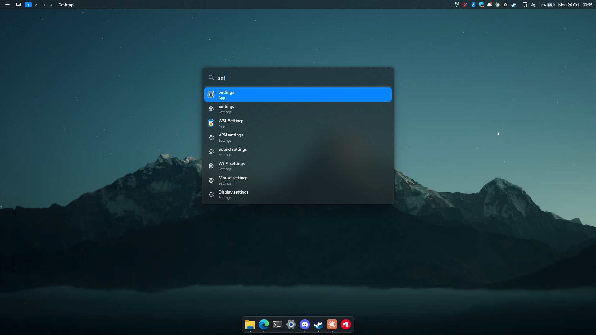 | |
| Launcher (Win+Alt+Space) | |
| 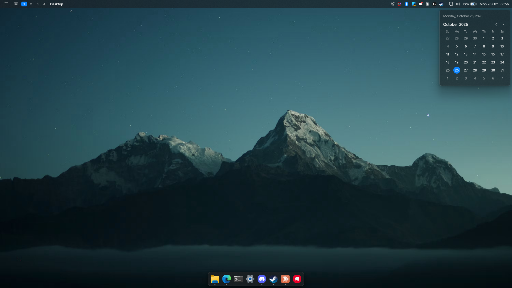 | 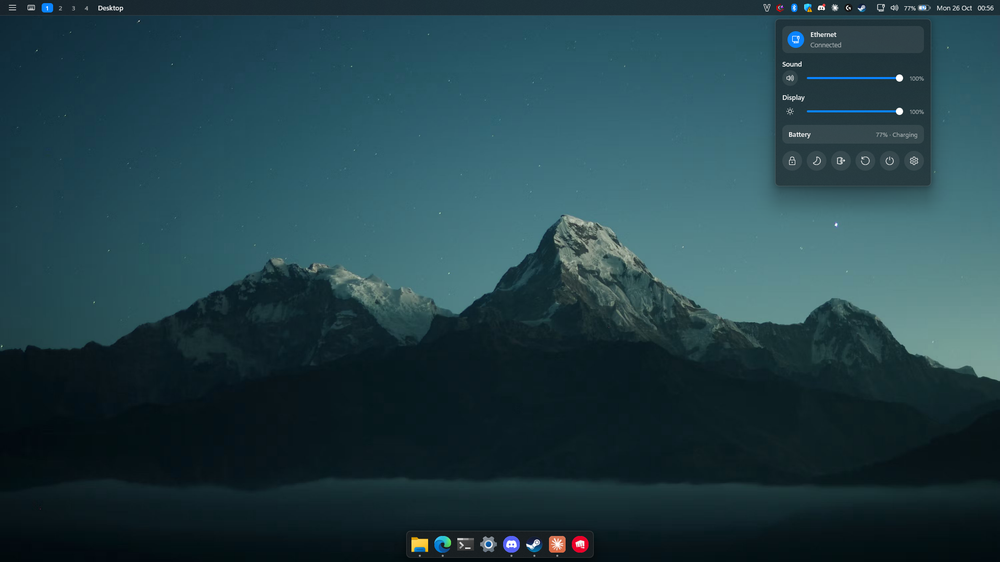 |
| Lịch | Quick Settings đang mở danh sách Wi-Fi và thiết bị âm thanh |
| 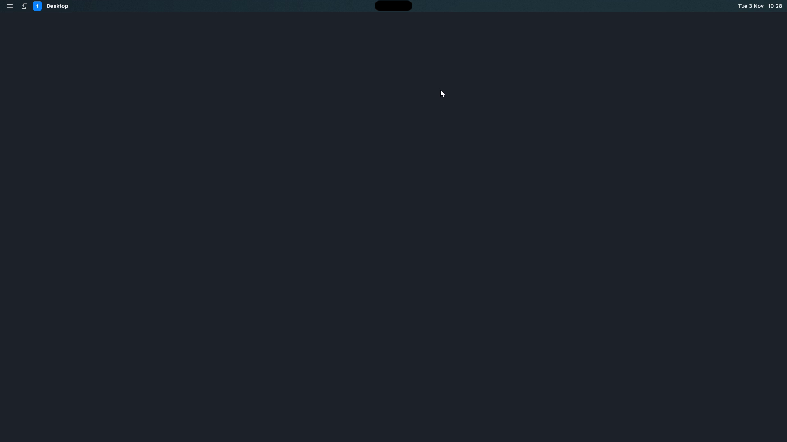 | |
| Dynamic Island mở rộng, tab Files | |
| 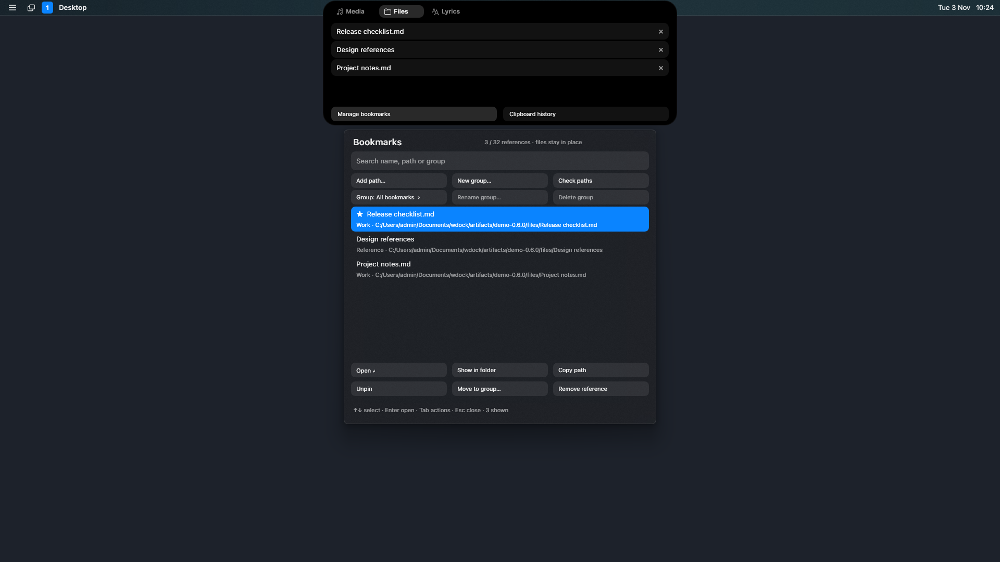 | 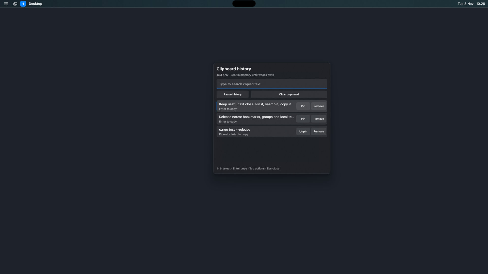 |
| Bookmark: tham chiếu, nhóm, tìm kiếm và ghim | Clipboard text: copy, ghim, tạm dừng và xóa |

## Tính năng

### Top bar

- Nút launcher và nút Overview.
- Các nút desktop ảo Windows đồng bộ trên mọi màn hình (Windows 11 24H2 từ build 26100.2605 hoặc 25H2 build 26200). Với build khác, nút được ẩn vì giao diện shell này không được Microsoft công bố.
- Tiêu đề cửa sổ đang mở.
- Khay hệ thống do wdock tự giữ: icon, thông báo balloon và phần tràn (overflow) hoạt động như trên taskbar.
- Biểu tượng âm lượng, mạng, pin; bấm vào để mở Quick Settings.
- Đồng hồ; bấm vào để mở lịch.

### Quick Settings

- **Mạng:** dòng kết nối mở rộng ra thành danh sách các mạng Wi-Fi đang thấy.
  - Mỗi mạng có tên, vạch sóng, ổ khóa nếu có mật khẩu, và chữ "Connected" ở mạng đang dùng. Danh sách sắp theo độ mạnh sóng, có nút quét lại.
  - Bấm vào mạng đã có profile lưu sẵn thì kết nối luôn. Với mạng mới, wdock không tự hỏi mật khẩu mà mở flyout Wi-Fi của Windows để bạn chọn mạng và nhập mật khẩu ở đó.
  - Khi Windows báo captive portal (mạng cần đăng nhập qua web), wdock mở trang đăng nhập bằng trình duyệt mặc định, mỗi kết nối một lần và không mở đè lên app toàn màn hình. Nút **Open sign-in page** trong danh sách dùng cho các portal mà Windows chỉ báo là local access.
  - Có công tắc bật/tắt Wi-Fi và nút ngắt kết nối. Máy không có Wi-Fi sẽ báo danh sách không khả dụng.
  - Chỉ quét mạng khi danh sách đang mở.
- **Âm thanh:** thanh âm lượng và danh sách thiết bị phát đang hoạt động (loa, tai nghe, HDMI, Bluetooth).
  - Bấm vào một thiết bị để đặt nó làm mặc định cho mọi vai trò; thanh âm lượng chuyển theo thiết bị mới.
  - Tính năng dùng interface chưa công bố `IPolicyConfig` như các công cụ đổi thiết bị khác. Nếu Windows từ chối, trang Sound settings sẽ mở ra thay thế.
- **Micro và camera:** chỉnh mức thu, tắt/bật và chọn micro mặc định trong Quick Settings. Cửa sổ xem thử camera dùng cùng màu nền, phông chữ và nút bo góc của wdock; hỗ trợ bàn phím, báo lỗi ngay trong cửa sổ, chuyển camera và mở cài đặt camera Windows. Đóng cửa sổ để giải phóng camera; không thu hình nền.
- **Màn hình:** mỗi màn hình điều khiển được có một thanh độ sáng, ghi tên màn hình: màn hình laptop qua WMI, màn hình ngoài qua DDC/CI. Màn hình không hỗ trợ DDC/CI thì không hiện. Việc dò màn hình chạy ở luồng riêng khi khởi động, khi đổi màn hình và sau khi thức dậy (không bao giờ dò định kỳ); khi kéo thanh chỉ ghi tối đa một lần mỗi 100 ms, cộng giá trị cuối khi thả.
- **Pin** và các nút khóa máy, ngủ, đăng xuất, khởi động lại, tắt máy, mở Settings. Các thao tác nguồn đều hỏi lại trước khi thực hiện.

### Dock

- App ghim và app đang chạy, có chấm dưới app đang chạy.
- Phóng to kiểu macOS, có nhãn tên.
- Xem trước cửa sổ trực tiếp khi rê chuột.
- Kéo thả để sắp xếp hoặc ghim, có menu chuột phải.
- Tự ẩn thông minh: dock trượt xuống khi có cửa sổ đè lên và hiện lại khi đưa chuột xuống đáy màn hình.

### Dynamic Island

Viên thuốc ở giữa đỉnh mỗi màn hình, rê chuột vào thì mở rộng.

- **Widget:** Island mở rộng có các tab Media và Files. Trong **wdock settings**, bật/tắt **Island file shelf** và đổi **Order (M/F)** để sắp xếp Media/Files. Pomodoro nằm trong Media.
- **Kiểu và thao tác:** trong wdock settings, chọn **Island style** để chuyển giữa Island và Notch; dùng **Notch width** để chỉnh độ rộng khi thu gọn. Cuộn ngang trên bảng mở rộng để đổi tab. Cuộn lên trên hàng tab để thu gọn, cuộn xuống trên notch hoặc island thu gọn để mở lại. Cuộn dọc trong Files vẫn dùng để xem danh sách tệp.
- **Files:** kéo file hoặc thư mục từ Explorer vào Island; kéo một mục ra ứng dụng tương thích, bấm để mở, hoặc bấm × để bỏ tham chiếu. Cuộn chuột để xem thêm. Khay lưu tối đa 32 đường dẫn, không sao chép nội dung; nếu file gốc bị xóa hoặc chuyển đi thì tham chiếu có thể không còn dùng được.

- **Bookmark:** chọn **Manage bookmarks** trong Files, hoặc tìm **Bookmarks** bằng launcher (Win+Alt+Space). Thêm đường dẫn file/thư mục, tìm kiếm, ghim, chia nhóm, mở vị trí trong Explorer hoặc copy đường dẫn. Xóa bookmark chỉ bỏ tham chiếu; xóa nhóm đưa các mục về danh sách chưa phân nhóm. Các mục của khay Files cũ được nhập tự động.

- **Clipboard text:** bật **Clipboard history (RAM)** trong wdock settings, rồi mở **Clipboard** từ Files hoặc tìm **Clipboard history** bằng launcher. Có tìm kiếm, copy, ghim, xóa, tạm dừng/tiếp tục thu thập và xóa các mục chưa ghim. Tính năng mặc định tắt; toàn bộ lịch sử, kể cả mục ghim, chỉ nằm trong RAM và mất khi thoát wdock hoặc tắt tính năng. Giới hạn 100 mục, mỗi mục tối đa 32 KiB text UTF-8 và tổng cộng 1 MiB. Không thu thập ảnh/file hay tự động paste. Việc thu thập dừng khi có app toàn màn hình ở phía trước; các thay đổi trong thời gian đó được bỏ qua. wdock tôn trọng format yêu cầu loại trừ khỏi lịch sử nếu ứng dụng nguồn cung cấp; cơ chế này không phát hiện được mọi nội dung bí mật.
- **Đang phát:** dùng được với mọi app có điều khiển media của Windows (Spotify, trình duyệt, trình phát nhạc).
- **Lyrics:** lời bài hát đồng bộ cho Spotify. Cần companion Spicetify và đang mở Spicy Lyrics hoặc Lyrics Plus; bridge gửi lời đang hiển thị cho wdock qua loopback (`127.0.0.1:43179`, chỉ nhận từ client Spotify). Cài bằng:

  ```bash
  powershell -ExecutionPolicy Bypass -File extensions\spicetify\install.ps1
  ```

  Script cần Spicetify ở `%LOCALAPPDATA%\spicetify` và không ghi đè file lạ. Tắt nền chuyển động của lời bài hát bằng **Lyrics background motion** trong cài đặt wdock.
  - Tên bài, ca sĩ, play/pause, bài trước/sau và thanh tiến độ kéo tua được.
  - Hiện ảnh bìa nếu app cung cấp. Nhiều trang web không có ảnh bìa (trình duyệt chỉ chuyển tiếp những gì trang khai báo), khi đó island hiện biểu tượng app đang phát, và khi mở rộng thì hiện khung hình trực tiếp của cửa sổ đang phát.
  - Equalizer chuyển động khi đang phát. Bộ dựng hình của Windows (DWM) tự chạy hoạt ảnh này, nên wdock không tốn công cho từng khung hình.
- **Pomodoro:** start, pause, reset ngay trên island mở rộng. Khi đang rảnh, bấm nhãn Focus / Break để chọn thời lượng cần sửa rồi dùng − / + (Focus 5-90 phút, bước 5; Break 1-30 phút, bước 1). Lựa chọn được nhớ trong `%LOCALAPPDATA%\wdock\pomodoro.txt`; `pomodoro_work` / `pomodoro_break` vẫn là giá trị mặc định. Viên thuốc thu gọn hiện số phút còn lại; hết mỗi phiên Focus hoặc Break có tiếng chuông và thông báo.
- **Chấm riêng tư:** chấm cam khi có app dùng micro, chấm xanh khi dùng camera, kèm thông báo ngắn lúc bắt đầu. wdock theo dõi kho consent của Windows bằng thông báo thay đổi registry, không polling.
- **Thông báo:** island giãn ra trong chốc lát khi đổi độ sáng, cắm/rút sạc, pin yếu, đổi mạng hoặc đổi thiết bị âm thanh. Thay đổi bằng thanh trượt của chính wdock thì island không giãn ra. Các pop-up gốc của Windows, bao gồm âm lượng, vẫn giữ nguyên.

### Launcher và cửa sổ

- **Launcher:** tìm gần đúng (fuzzy) trong các app đã cài (Win32 và Store) và các trang Settings.
- **Overview** các cửa sổ của desktop Windows hiện tại. Bấm số desktop để chuyển; kéo cửa sổ trong Overview vào desktop để di chuyển cửa sổ.

### Icon khay

- Kéo icon vào mũi tên để ẩn, hoặc kéo icon từ hộp ra top bar để hiện. Menu chuột phải cũng có **Hide from top bar** và **Show on top bar**.
- wdock đọc cài đặt icon khay của Windows khi nhận diện được icon; thay đổi trong Windows được cập nhật, trừ khi bạn đã chọn riêng vị trí đó trong wdock.
- Lựa chọn được lưu theo từng app trong `%LOCALAPPDATA%\wdock	ray-hidden.txt`, khớp theo tên file thực thi (và theo GUID của icon khi app có GUID).
- Cùng menu đó có **Open the app's menu** để chuyển cú nhấp chuột cho app.

### Game mode

Khi có app toàn màn hình ở phía trước (game, video toàn màn hình, F11 trên trình duyệt), top bar, dock và island trên màn hình đó bị ẩn, ngừng vẽ và ngừng chạy timer. wdock cũng ngừng theo dõi việc di chuyển bên trong game, nên CPU là 0%.

## Cách hoạt động

Explorer vẫn là shell của Windows ("chế độ lai"), wdock chạy song song với nó:

- **Taskbar của explorer** bị ẩn bằng auto-hide cộng SW_HIDE. Trạng thái gốc được lưu vào `%LOCALAPPDATA%\wdock\taskbar.txt` và được trả lại khi wdock thoát, khi wdock crash quá nhiều lần, hoặc khi kết thúc phiên đăng nhập.
- **Top bar** đăng ký làm AppBar, nên explorer giữ cửa sổ maximize nằm dưới nó.
  - Sau khi dựng thanh và sau khi thoát app toàn màn hình, wdock kiểm tra xem chỗ dành cho thanh đã thật sự được giữ chưa.
  - Nếu explorer không giữ chỗ, wdock đăng ký lại. Nếu vẫn không được, wdock tự đặt work area cho màn hình đó và trả lại khi thoát.
- **Dock** ở chế độ smart không giữ chỗ. Với `auto_hide = "off"`, dock đăng ký thêm một AppBar ở đáy.
- **Khay hệ thống:** wdock giữ cửa sổ mà các app gửi icon khay tới, và chuyển tiếp cho taskbar của explorer những thông điệp nó không xử lý.
- **Phím tắt:** wdock chỉ đăng ký hai tổ hợp bằng `RegisterHotKey`: Win+Alt+Space và Ctrl+Alt+Shift+Q. Mọi thao tác khác dùng chuột, còn phím tắt của Windows (Alt+Tab, Win+Tab, Win+Shift+S, ...) vẫn hoạt động.
- **Vẽ giao diện:** mặc định dùng Direct2D trên CPU (WARP), ghép hình bằng DirectComposition và hiệu ứng acrylic của DWM. Mọi thứ chạy theo sự kiện; khi không có gì thay đổi thì không timer nào chạy.

## Cài đặt

### Từ bản phát hành (khuyên dùng)

1. Tải `wdock-setup-<version>.exe` ở [bản phát hành mới nhất](https://github.com/Buim1nh/wdock/releases/latest).
2. Chạy file đó, chọn các tùy chọn rồi bấm **Install**. Bộ cài cài wdock cho tài khoản của bạn (không cần admin), khởi động wdock và thêm nó vào **Settings > Apps**.
3. Windows SmartScreen có thể cảnh báo vì file chưa được ký số: chọn **More info > Run anyway**.

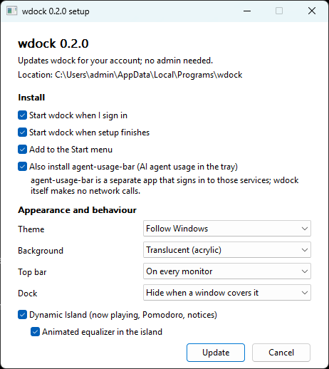

Cửa sổ cài đặt có các tùy chọn:

| Tùy chọn | Mặc định |
|---|---|
| Tự chạy wdock khi đăng nhập | bật |
| Chạy wdock ngay khi cài xong | bật |
| Thêm vào Start menu | bật |
| Cài thêm agent-usage-bar (mức sử dụng AI agent trên khay) | tắt (bật sẵn nếu máy đã cài) |
| Theme: theo Windows, tối, sáng | theo Windows |
| Nền: trong mờ (acrylic) hoặc đặc | trong mờ |
| Top bar: trên mọi màn hình hoặc chỉ màn hình chính | mọi màn hình |
| Dock: ẩn khi có cửa sổ che, luôn tự ẩn, luôn hiện | ẩn khi bị che |
| Dynamic Island và equalizer chuyển động | bật, bật |

Chạy lại bộ cài sẽ cập nhật wdock và hiện các thiết lập hiện tại, nên bạn cũng dùng nó để đổi thiết lập được. Chỉ những tùy chọn bạn đổi mới được ghi vào `config.toml`.

Để gỡ wdock, vào **Settings > Apps > wdock > Uninstall**, hoặc chạy `%LOCALAPPDATA%\Programs\wdock\uninstall.exe --uninstall`. agent-usage-bar có mục riêng trong Settings > Apps.

Để cài im lặng, chạy `wdock-setup-<version>.exe /S`, có thể thêm `/WithUsage /NoSignIn /NoStart /NoShortcut /NoIsland /NoEqualizer /Theme=auto|dark|light /Backdrop=acrylic|solid /TopBar=all|primary /AutoHide=smart|on|off`. Nếu cài im lặng bị lỗi, lý do được ghi vào `%TEMP%\wdock-setup.log`. Trình gỡ cũng nhận cờ `/S`.

Bản phát hành còn có file zip dạng portable gồm `wdock.exe` và các script cài đặt.

### Từ mã nguồn

Để build cần [Rust toolchain](https://rustup.rs) (stable, edition 2024). Cài đặt không cần quyền admin.

```bash
powershell -ExecutionPolicy Bypass -File scripts\install.ps1
```

Script này:

1. Build bản release.
2. Copy file chạy vào `%LOCALAPPDATA%\Programs\wdock\wdock.exe`.
3. Tạo scheduled task tên `wdock` cho tài khoản của bạn, chạy `"<exe>" --guard` mỗi lần đăng nhập.
4. Khởi động wdock ngay.

Dùng scheduled task thay cho khóa registry `Run` vì khi script chạy từ terminal bên trong một app dạng gói (MSIX), Windows chuyển hướng các thay đổi `HKCU` vào gói đó, và explorer sẽ không bao giờ thấy mục `Run`.

Các tùy chọn:

| Tùy chọn | Tác dụng |
|---|---|
| `-NoBuild` | dùng bản `target\release` đã build |
| `-NoStart` | chỉ cài, không khởi động wdock |
| `-WithUsage` | cài thêm [agent-usage-bar](https://github.com/Buim1nh/agent-usage-bar) (xem bên dưới) |
| `-UsageRepo <path>` | thư mục mã nguồn của agent-usage-bar (mặc định là thư mục `agent-usage-bar` cạnh repo này, tự clone nếu chưa có) |

Cần thoát wdock trước khi cài đè.

**agent-usage-bar** là một app khay riêng, không bắt buộc. Nó hiện mức sử dụng của Claude, Codex, Antigravity (và biểu đồ đóng góp GitHub) trên top bar của wdock. App được tách riêng để bản thân wdock vẫn không giữ thông tin đăng nhập và không gọi mạng. Nó tự chạy khi đăng nhập bằng scheduled task riêng. Mặc định không cài.

**Guard:** tiến trình `--guard` chạy lúc đăng nhập sẽ chạy shell dưới dạng tiến trình con `--shell`.

- Nếu shell crash, guard khởi động lại nó sau khoảng 1 giây.
- Nếu crash 3 lần trong 60 giây, guard bỏ cuộc và trả lại taskbar của explorer.
- Mỗi phiên đăng nhập chỉ chạy một guard.

## Phím tắt

| Phím | Chức năng |
|---|---|
| Win+Alt+Space | Launcher |
| Ctrl+Alt+Shift+Q | Thoát wdock, trả lại taskbar của explorer |

Nếu Win+Alt+Space đã bị app khác chiếm, wdock ghi vào log và launcher vẫn mở bằng nút trên top bar. Virtual desktop và Overview dùng chuột.

## Tùy chỉnh

Thay đổi tùy chọn không cần chạy lại trình cài đặt. Bấm vào các icon trạng thái trên top bar, rồi chọn **Cài đặt wdock**. Panel này chỉnh được:

- giao diện, nền (backdrop), top bar trên tất cả màn hình hoặc chỉ màn hình chính
- font (kèm **Use font in Windows** / **Windows default font**)
- tự ẩn dock, hiệu ứng hover (magnify hoặc glass), kích thước icon và kích thước khi hover
- Dynamic Island bật/tắt, kiểu (Island hoặc Notch) và độ rộng notch, hiệu ứng equalizer, nền chuyển động của lời bài hát, kệ file và thứ tự tab; bật/tắt lịch sử clipboard text trong RAM
- khởi động cùng Windows (một tác vụ theo người dùng tên `wdock`, cùng tác vụ mà trình cài đặt tạo)

Mỗi thay đổi được lưu vào `config.toml` (giữ nguyên chú thích và các khóa khác) và áp dụng ngay. **Mở file cấu hình** mở file trong trình soạn thảo mặc định, để chỉnh các khóa khác.

Các khóa không có trong panel vẫn cần khởi động lại: bấm Ctrl+Alt+Shift+Q rồi chạy `Start-ScheduledTask wdock` trong PowerShell, hoặc đăng xuất rồi đăng nhập lại.

## Cấu hình

File cấu hình là `%APPDATA%\wdock\config.toml`, được tạo tự động từ mẫu có chú thích ở lần chạy đầu.

- Lưu file dưới dạng UTF-8 không có BOM.
- Sửa trực tiếp trong file chỉ có hiệu lực sau khi khởi động lại wdock: bấm Ctrl+Alt+Shift+Q rồi chạy `Start-ScheduledTask wdock` trong PowerShell, hoặc đăng xuất rồi đăng nhập lại.

| Mục | Thiết lập chính |
|---|---|
| `[appearance]` | `theme` = `"auto"`, `"dark"` hoặc `"light"`; `backdrop` = `"acrylic"` hoặc `"solid"`; `font` = `"auto"` (SF Pro nếu đã cài, không thì Segoe UI Variable) hoặc tên bất kỳ font đã cài |
| `[performance]` | `renderer` = `"software"` (WARP, khoảng 10 MB, không đánh thức GPU rời) hoặc `"gpu"` |
| `[topbar]` | `height` (30), `monitors` (`"all"` hoặc `"primary"`), `date_format`, `time_format` |
| `[tray]` | `max_visible`: số icon trước nút tràn (12); `overflow`: các tên file chạy luôn bị đưa vào phần tràn |
| `[dock]` | `icon_size` (32), `hover_effect` (`"magnify"` hoặc `"glass"`), `hover_size` tùy chọn, `magnification` cũ (2.0), `monitors`, `windows`, `auto_hide`, `pinned` |
| `[island]` | `enabled`, `style` (`"island"` hoặc `"notch"`), `notch_width` (200), `lyrics_background_motion`, `file_shelf`, `clipboard_history` (false, chỉ text trong RAM), `widget_order`, `pomodoro_work`, `pomodoro_break`, `notices`, `animate_equalizer` |

Để Windows cũng dùng font đó, mở wdock settings và bấm **Use font in Windows** (cần quyền admin; đăng xuất rồi đăng nhập lại để áp dụng). wdock thay các họ font Segoe UI và cài trước các file `.ttf`/`.otf` còn thiếu trong `%LOCALAPPDATA%\wdock\fonts`. **Windows default font** trả lại như cũ. SF Pro không được đóng gói sẵn vì Apple không cho phép phân phối lại; xem `fonts\README.md`.

Khi chưa có danh sách ghim riêng, wdock nhập các app từ taskbar Windows theo thứ tự và sao chép shortcut vào thư mục dữ liệu của mình. Các thay đổi sau đó chỉ lưu vào `%LOCALAPPDATA%\wdock\pinned.txt`, không sửa taskbar Windows. Nếu nhập thất bại, wdock tạm dùng danh sách trong cấu hình và thử lại lần khởi động sau. Giao diện Windows dùng để nhập chưa được Microsoft công bố.

Trong **wdock settings**, chọn **Dock hover** để đổi giữa phóng to và Glass; dùng dấu −/+ ở **Icon size** và **Hover size** để chỉnh kích thước. Đơn vị là pixel độc lập DPI (Windows scale được áp dụng theo từng màn hình). Icon thường từ 16–96, icon khi hover tối đa 192 và không quá 3 lần kích thước thường. `hover_size` chỉ có tác dụng trong chế độ phóng to; khi chưa đặt, `magnification` cũ vẫn được tôn trọng.

Dữ liệu và log nằm trong `%LOCALAPPDATA%\wdock\`:

| File | Nội dung |
|---|---|
| `logs\wdock.log`, `logs\wdock-guard.log` | log (xoay vòng khi vượt 2 MB) |
| `pinned.txt` | app ghim, theo thứ tự trên dock |
| `taskbar.txt` | trạng thái auto-hide gốc của explorer |
| `tray-hidden.txt`, `tray-shown.txt` | lựa chọn vị trí icon khay trong wdock |
| `bookmarks.toml` | tham chiếu file/thư mục, mục ghim và nhóm; giữ `island-files.txt` cũ làm bản dự phòng khi chuyển dữ liệu |

## Xử lý sự cố

| Sự cố | Cách xử lý |
|---|---|
| Top bar đè lên cửa sổ maximize | wdock tự sửa trong vài giây (xem [Cách hoạt động](#cách-hoạt-động)). Lỗi xảy ra khi bộ quản lý AppBar của explorer bị kẹt, ví dụ sau khi wdock bị khởi động lại liên tục nhiều lần. Nếu vẫn còn, khởi động lại explorer trong Task Manager. |
| wdock bị lag hoặc dock không hiện nữa | Gõ `reload` trong launcher (Win+Alt+Space) hoặc bấm nút đó ở cuối phần cài đặt của wdock. Nếu giao diện không phản hồi, chạy `"%LOCALAPPDATA%\Programs\wdock\wdock.exe" --reload`. Trạng thái lúc đó được ghi vào `wdock.log`. |
| Taskbar của explorer không hiện lại sau khi wdock bị kill | Chạy `"%LOCALAPPDATA%\Programs\wdock\wdock.exe" --restore-taskbar`. |
| Thiếu một icon khay | Khởi động lại app sở hữu icon đó. wdock yêu cầu các app thêm lại icon lúc khởi động và thêm một lần sau 5 giây. |
| Island không có ảnh bìa khi xem video | Trang web không khai báo ảnh bìa. Island sẽ hiện biểu tượng app, và khi mở rộng thì hiện khung hình trực tiếp của cửa sổ. |
| wdock không tự chạy khi đăng nhập | Kiểm tra task `wdock` trong Task Scheduler, hoặc chạy lại `scripts\install.ps1 -NoBuild`. |

## Gỡ cài đặt

```bash
powershell -ExecutionPolicy Bypass -File scripts\uninstall.ps1
```

Script này:

1. Gỡ scheduled task (và mục `Run` của các bản cài cũ).
2. Dừng guard rồi dừng shell.
3. Trả lại taskbar của explorer (và các cửa sổ mà bản cũ còn để ẩn).

`-RemoveFiles` xóa luôn file chạy, `-RemoveData` xóa log, cache và trạng thái. File cấu hình luôn được giữ lại.

## Phát triển

| Lệnh | Mục đích |
|---|---|
| `cargo run --release -- --dev` | chạy kèm supervisor dev, tự khởi động lại khi crash, ghi log vào `wdock-dev.log` |
| `cargo test --release` | chạy unit test |
| `cargo clippy --release --workspace` | kiểm tra lint (hiện không có cảnh báo nào) |
| `cargo build --release -p wdock && cargo build --release -p wdock-setup` | build bộ cài, có nhúng `wdock.exe` (`crates/wdock-setup`) |

Các chế độ dòng lệnh:

| Tham số | Chế độ |
|---|---|
| không có hoặc `--shell` | chạy shell |
| `--guard` | supervisor lúc đăng nhập |
| `--dev` | supervisor dev |
| `--reload` | dựng lại shell đang chạy, hoặc khởi động lại nếu nó bị treo, rồi thoát |
| `--restore-taskbar` | trả lại taskbar của explorer và các cửa sổ đang ẩn, rồi thoát |

Mã nguồn nằm trong `crates/wdock/src`:

| Thư mục | Nội dung |
|---|---|
| `app.rs` | vòng lặp message, hai phím tắt, game mode, kiểm tra AppBar |
| `ui/` | các thanh Direct2D, dock, island, popup, lớp composition |
| `platform/` | lớp bọc Win32, tray host, AppBar, sự kiện cửa sổ |
| `services/` | âm thanh, mạng và Wi-Fi, nguồn, độ sáng, phiên media, bridge lời bài hát, chỉ mục app, icon |
| `model/` | cấu hình, cửa sổ, khay, pin, tìm kiếm, Pomodoro, kệ file của Island |

Ngoài crate: `crates/wdock-setup` (trình cài đặt), `extensions/` (bridge lời bài hát cho Spicetify và extension trình duyệt WDock Lyrics), `scripts/` (cài, gỡ, font Windows). Agent lập trình nên đọc [AGENTS.md](AGENTS.md) trước.

## Kết quả đo

Bản release trên Windows 11, 2 màn hình 1080p.

| Hạng mục | Kết quả |
|---|---|
| Working set riêng (shell / guard) | ~14–19 MB / ~1,2 MB |
| CPU khi rảnh | 15–110 ms mỗi 60 giây (dưới 0,2%) |
| CPU khi đang phát media (equalizer chuyển động) | ~16 ms mỗi 60 giây; tải của DWM không đổi |
| CPU khi có app toàn màn hình ở phía trước | 0 ms trong 20 giây |
| Thời gian phát hiện F11/toàn màn hình | ~15 ms |
| Rò rỉ (200 lần mở/đóng overview + 20 lần launcher) | handle ổn định, GDI 40–43, bộ nhớ dừng ở một mức |
| Shell crash | guard khởi động lại sau ~1 giây; icon khay hiện lại, taskbar vẫn ẩn |

## Giấy phép

MIT
