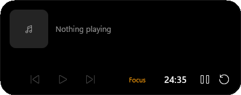
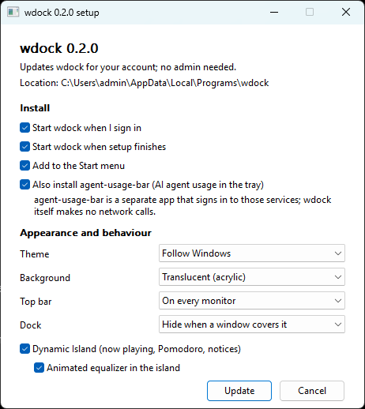

# wdock

[English](README.md) · **Tiếng Việt**

wdock là bộ top bar, dock và Dynamic Island kiểu macOS cho Windows 11, viết bằng Rust.

- Mục tiêu tài nguyên: RAM dưới 25 MB, CPU gần 0% khi rảnh, 0% khi đang chơi game.
- Không inject code vào tiến trình khác, không dùng keyboard hook, không tự gọi mạng, nên an toàn khi chạy cùng anti-cheat.
- Chạy song song với explorer chứ không thay thế nó. Các tính năng của Windows vẫn hoạt động, và thoát wdock thì taskbar bình thường quay lại.

[](docs/media/demo.mp4)

*Video demo gồm dock phóng to, launcher, icon khay, lịch và Quick Settings. Bấm vào để xem bản MP4 1080p.*

## Mục lục

- [Ảnh chụp màn hình](#ảnh-chụp-màn-hình)
- [Tính năng](#tính-năng)
- [Cách hoạt động](#cách-hoạt-động)
- [Cài đặt](#cài-đặt)
- [Phím tắt](#phím-tắt)
- [Cấu hình](#cấu-hình)
- [Xử lý sự cố](#xử-lý-sự-cố)
- [Gỡ cài đặt](#gỡ-cài-đặt)
- [Phát triển](#phát-triển)
- [Kết quả đo](#kết-quả-đo)

## Ảnh chụp màn hình

Tất cả ảnh có độ phân giải 1920×1080.

| | |
|---|---|
|  |  |
| Top bar và dock | Dock phóng to kèm nhãn tên |
|  | |
| Launcher (Win+Alt+Space) | |
|  |  |
| Lịch | Quick Settings đang mở danh sách Wi-Fi và thiết bị âm thanh |
|  | |
| Dynamic Island mở rộng | |

## Tính năng

### Top bar

- Nút launcher và nút Overview.
- Ô chọn workspace (mặc định 4 workspace cho mỗi màn hình).
- Tiêu đề cửa sổ đang mở.
- Khay hệ thống do wdock tự giữ: icon, thông báo balloon và phần tràn (overflow) hoạt động như trên taskbar.
- Biểu tượng âm lượng, mạng, pin; bấm vào để mở Quick Settings.
- Đồng hồ; bấm vào để mở lịch.

### Quick Settings

- **Mạng:** dòng kết nối mở rộng ra thành danh sách các mạng Wi-Fi đang thấy.
  - Mỗi mạng có tên, vạch sóng, ổ khóa nếu có mật khẩu, và chữ "Connected" ở mạng đang dùng. Danh sách sắp theo độ mạnh sóng, có nút quét lại.
  - Bấm vào mạng đã có profile lưu sẵn thì kết nối luôn. Với mạng mới, wdock không tự hỏi mật khẩu mà mở trang Wi-Fi của Windows.
  - Có công tắc bật/tắt Wi-Fi và nút ngắt kết nối. Máy không có Wi-Fi sẽ báo danh sách không khả dụng.
  - Chỉ quét mạng khi danh sách đang mở.
- **Âm thanh:** thanh âm lượng và danh sách thiết bị phát đang hoạt động (loa, tai nghe, HDMI, Bluetooth).
  - Bấm vào một thiết bị để đặt nó làm mặc định cho mọi vai trò; thanh âm lượng chuyển theo thiết bị mới.
  - Tính năng dùng interface chưa công bố `IPolicyConfig` như các công cụ đổi thiết bị khác. Nếu Windows từ chối, trang Sound settings sẽ mở ra thay thế.
- **Màn hình:** thanh độ sáng, với màn hình hỗ trợ.
- **Pin** và các nút khóa máy, ngủ, đăng xuất, khởi động lại, tắt máy, mở Settings. Các thao tác nguồn đều hỏi lại trước khi thực hiện.

### Dock

- App ghim và app đang chạy, có chấm dưới app đang chạy.
- Phóng to kiểu macOS, có nhãn tên.
- Xem trước cửa sổ trực tiếp khi rê chuột.
- Kéo thả để sắp xếp hoặc ghim, có menu chuột phải.
- Tự ẩn thông minh: dock trượt xuống khi có cửa sổ đè lên và hiện lại khi đưa chuột xuống đáy màn hình.

### Dynamic Island

Viên thuốc ở giữa đỉnh mỗi màn hình, rê chuột vào thì mở rộng.

- **Đang phát:** dùng được với mọi app có điều khiển media của Windows (Spotify, trình duyệt, trình phát nhạc).
  - Tên bài, ca sĩ, play/pause, bài trước/sau và thanh tiến độ kéo tua được.
  - Hiện ảnh bìa nếu app cung cấp. Nhiều trang web không có ảnh bìa (trình duyệt chỉ chuyển tiếp những gì trang khai báo), khi đó island hiện biểu tượng app đang phát, và khi mở rộng thì hiện khung hình trực tiếp của cửa sổ đang phát.
  - Equalizer chuyển động khi đang phát. Bộ dựng hình của Windows (DWM) tự chạy hoạt ảnh này, nên wdock không tốn công cho từng khung hình.
- **Pomodoro:** start, pause, reset ngay trên island mở rộng. Khi đang rảnh, bấm nhãn Focus / Break để chọn thời lượng cần sửa rồi dùng − / + (Focus 5-90 phút, bước 5; Break 1-30 phút, bước 1). Lựa chọn được nhớ trong `%LOCALAPPDATA%\wdock\pomodoro.txt`; `pomodoro_work` / `pomodoro_break` vẫn là giá trị mặc định. Viên thuốc thu gọn hiện số phút còn lại; hết mỗi phiên Focus hoặc Break có tiếng chuông và thông báo.
- **Chấm riêng tư:** chấm cam khi có app dùng micro, chấm xanh khi dùng camera, kèm thông báo ngắn lúc bắt đầu. wdock theo dõi kho consent của Windows bằng thông báo thay đổi registry, không polling.
- **Thông báo:** island giãn ra trong chốc lát khi đổi âm lượng, độ sáng, cắm/rút sạc, pin yếu, đổi mạng hoặc đổi thiết bị âm thanh. Các pop-up gốc của Windows vẫn giữ nguyên.

### Launcher và cửa sổ

- **Launcher:** tìm gần đúng (fuzzy) trong các app đã cài (Win32 và Store) và các trang Settings.
- **Overview** các cửa sổ của workspace hiện tại (nút cạnh launcher, hoặc bấm số workspace đang chọn), và **workspace ảo** cho từng màn hình. Bấm một số workspace để chuyển sang đó.

### Icon khay

- Bấm chuột phải vào icon trên top bar, chọn **Hide from top bar** để chuyển icon vào nút mũi tên tràn. Nút này chỉ hiện khi có icon bị ẩn. **Show on top bar** đưa icon trở lại.
- Lựa chọn được lưu theo từng app trong `%LOCALAPPDATA%\wdock	ray-hidden.txt`, khớp theo tên file thực thi (và theo GUID của icon khi app có GUID).
- Cùng menu đó có **Open the app's menu** để chuyển cú nhấp chuột cho app.

### Game mode

Khi có app toàn màn hình ở phía trước (game, video toàn màn hình, F11 trên trình duyệt), top bar, dock và island trên màn hình đó bị ẩn, ngừng vẽ và ngừng chạy timer. wdock cũng ngừng theo dõi việc di chuyển bên trong game, nên CPU là 0%.

## Cách hoạt động

Explorer vẫn là shell của Windows ("chế độ lai"), wdock chạy song song với nó:

- **Taskbar của explorer** bị ẩn bằng auto-hide cộng SW_HIDE. Trạng thái gốc được lưu vào `%LOCALAPPDATA%\wdock\taskbar.txt` và được trả lại khi wdock thoát, khi wdock crash quá nhiều lần, hoặc khi kết thúc phiên đăng nhập.
- **Top bar** đăng ký làm AppBar, nên explorer giữ cửa sổ maximize nằm dưới nó.
  - Sau khi dựng thanh và sau khi thoát app toàn màn hình, wdock kiểm tra xem chỗ dành cho thanh đã thật sự được giữ chưa.
  - Nếu explorer không giữ chỗ, wdock đăng ký lại. Nếu vẫn không được, wdock tự đặt work area cho màn hình đó và trả lại khi thoát.
- **Dock** ở chế độ smart không giữ chỗ. Với `auto_hide = "off"`, dock đăng ký thêm một AppBar ở đáy.
- **Khay hệ thống:** wdock giữ cửa sổ mà các app gửi icon khay tới, và chuyển tiếp cho taskbar của explorer những thông điệp nó không xử lý.
- **Phím tắt:** wdock chỉ đăng ký hai tổ hợp bằng `RegisterHotKey`: Win+Alt+Space và Ctrl+Alt+Shift+Q. Mọi thao tác khác dùng chuột, còn phím tắt của Windows (Alt+Tab, Win+Tab, Win+Shift+S, ...) vẫn hoạt động.
- **Vẽ giao diện:** mặc định dùng Direct2D trên CPU (WARP), ghép hình bằng DirectComposition và hiệu ứng acrylic của DWM. Mọi thứ chạy theo sự kiện; khi không có gì thay đổi thì không timer nào chạy.

## Cài đặt

### Từ bản phát hành (khuyên dùng)

1. Tải `wdock-setup-<version>.exe` ở [bản phát hành mới nhất](https://github.com/Buim1nh/wdock/releases/latest).
2. Chạy file đó, chọn các tùy chọn rồi bấm **Install**. Bộ cài cài wdock cho tài khoản của bạn (không cần admin), khởi động wdock và thêm nó vào **Settings > Apps**.
3. Windows SmartScreen có thể cảnh báo vì file chưa được ký số: chọn **More info > Run anyway**.



Cửa sổ cài đặt có các tùy chọn:

| Tùy chọn | Mặc định |
|---|---|
| Tự chạy wdock khi đăng nhập | bật |
| Chạy wdock ngay khi cài xong | bật |
| Thêm vào Start menu | bật |
| Cài thêm agent-usage-bar (mức sử dụng AI agent trên khay) | tắt (bật sẵn nếu máy đã cài) |
| Theme: theo Windows, tối, sáng | theo Windows |
| Nền: trong mờ (acrylic) hoặc đặc | trong mờ |
| Top bar: trên mọi màn hình hoặc chỉ màn hình chính | mọi màn hình |
| Dock: ẩn khi có cửa sổ che, luôn tự ẩn, luôn hiện | ẩn khi bị che |
| Dynamic Island và equalizer chuyển động | bật, bật |

Chạy lại bộ cài sẽ cập nhật wdock và hiện các thiết lập hiện tại, nên bạn cũng dùng nó để đổi thiết lập được. Chỉ những tùy chọn bạn đổi mới được ghi vào `config.toml`.

Để gỡ wdock, vào **Settings > Apps > wdock > Uninstall**, hoặc chạy `%LOCALAPPDATA%\Programs\wdock\uninstall.exe --uninstall`. agent-usage-bar có mục riêng trong Settings > Apps.

Để cài im lặng, chạy `wdock-setup-<version>.exe /S`, có thể thêm `/WithUsage /NoSignIn /NoStart /NoShortcut /NoIsland /NoEqualizer /Theme=auto|dark|light /Backdrop=acrylic|solid /TopBar=all|primary /AutoHide=smart|on|off`. Nếu cài im lặng bị lỗi, lý do được ghi vào `%TEMP%\wdock-setup.log`. Trình gỡ cũng nhận cờ `/S`.

Bản phát hành còn có file zip dạng portable gồm `wdock.exe` và các script cài đặt.

### Từ mã nguồn

Để build cần [Rust toolchain](https://rustup.rs) (stable, edition 2024). Cài đặt không cần quyền admin.

```bash
powershell -ExecutionPolicy Bypass -File scripts\install.ps1
```

Script này:

1. Build bản release.
2. Copy file chạy vào `%LOCALAPPDATA%\Programs\wdock\wdock.exe`.
3. Tạo scheduled task tên `wdock` cho tài khoản của bạn, chạy `"<exe>" --guard` mỗi lần đăng nhập.
4. Khởi động wdock ngay.

Dùng scheduled task thay cho khóa registry `Run` vì khi script chạy từ terminal bên trong một app dạng gói (MSIX), Windows chuyển hướng các thay đổi `HKCU` vào gói đó, và explorer sẽ không bao giờ thấy mục `Run`.

Các tùy chọn:

| Tùy chọn | Tác dụng |
|---|---|
| `-NoBuild` | dùng bản `target\release` đã build |
| `-NoStart` | chỉ cài, không khởi động wdock |
| `-WithUsage` | cài thêm [agent-usage-bar](https://github.com/Buim1nh/agent-usage-bar) (xem bên dưới) |
| `-UsageRepo <path>` | thư mục mã nguồn của agent-usage-bar (mặc định là thư mục `agent-usage-bar` cạnh repo này, tự clone nếu chưa có) |

Cần thoát wdock trước khi cài đè.

**agent-usage-bar** là một app khay riêng, không bắt buộc. Nó hiện mức sử dụng của Claude, Codex, Antigravity (và biểu đồ đóng góp GitHub) trên top bar của wdock. App được tách riêng để bản thân wdock vẫn không giữ thông tin đăng nhập và không gọi mạng. Nó tự chạy khi đăng nhập bằng scheduled task riêng. Mặc định không cài.

**Guard:** tiến trình `--guard` chạy lúc đăng nhập sẽ chạy shell dưới dạng tiến trình con `--shell`.

- Nếu shell crash, guard khởi động lại nó sau khoảng 1 giây.
- Nếu crash 3 lần trong 60 giây, guard bỏ cuộc và trả lại taskbar của explorer.
- Mỗi phiên đăng nhập chỉ chạy một guard.

## Phím tắt

| Phím | Chức năng |
|---|---|
| Win+Alt+Space | Launcher |
| Ctrl+Alt+Shift+Q | Thoát wdock, trả lại taskbar của explorer |

Nếu Win+Alt+Space đã bị app khác chiếm, wdock ghi vào log và launcher vẫn mở bằng nút trên top bar. Workspace và Overview dùng chuột.

## Cấu hình

File cấu hình là `%APPDATA%\wdock\config.toml`, được tạo tự động từ mẫu có chú thích ở lần chạy đầu.

- Lưu file dưới dạng UTF-8 không có BOM.
- Thay đổi chỉ có hiệu lực sau khi khởi động lại wdock: bấm Ctrl+Alt+Shift+Q rồi chạy `Start-ScheduledTask wdock` trong PowerShell, hoặc đăng xuất rồi đăng nhập lại.

| Mục | Thiết lập chính |
|---|---|
| `[appearance]` | `theme` = `"auto"`, `"dark"` hoặc `"light"`; `backdrop` = `"acrylic"` hoặc `"solid"` |
| `[performance]` | `renderer` = `"software"` (WARP, khoảng 10 MB, không đánh thức GPU rời) hoặc `"gpu"` |
| `[topbar]` | `height` (30), `monitors` (`"all"` hoặc `"primary"`), `date_format`, `time_format` |
| `[tray]` | `max_visible`: số icon trước nút tràn (12); `overflow`: các tên file chạy luôn bị đưa vào phần tràn |
| `[dock]` | `icon_size` (32), `monitors` (`"primary"`), `windows` (`"all"` hoặc `"this-monitor"`), `magnification` (2.0), `auto_hide` (`"smart"`, `"on"`, `"off"`), `pinned` |
| `[workspaces]` | `count`: số workspace mỗi màn hình (4, tối đa 9) |
| `[island]` | `enabled` (true), `pomodoro_work` (25), `pomodoro_break` (5), `notices` (true), `animate_equalizer` (true) |

Ghim, bỏ ghim hoặc sắp xếp lại trên dock sẽ lưu danh sách vào `%LOCALAPPDATA%\wdock\pinned.txt`, và file này được ưu tiên hơn `pinned`; xóa file đó để quay lại dùng cấu hình.

Dữ liệu và log nằm trong `%LOCALAPPDATA%\wdock\`:

| File | Nội dung |
|---|---|
| `logs\wdock.log`, `logs\wdock-guard.log` | log (xoay vòng khi vượt 2 MB) |
| `pinned.txt` | app ghim, theo thứ tự trên dock |
| `hidden.txt` | cửa sổ đang ở workspace khác |
| `taskbar.txt` | trạng thái auto-hide gốc của explorer |
| `tray-hidden.txt` | icon khay bị ẩn khỏi top bar |

## Xử lý sự cố

| Sự cố | Cách xử lý |
|---|---|
| Top bar đè lên cửa sổ maximize | wdock tự sửa trong vài giây (xem [Cách hoạt động](#cách-hoạt-động)). Lỗi xảy ra khi bộ quản lý AppBar của explorer bị kẹt, ví dụ sau khi wdock bị khởi động lại liên tục nhiều lần. Nếu vẫn còn, khởi động lại explorer trong Task Manager. |
| Taskbar của explorer không hiện lại sau khi wdock bị kill | Chạy `"%LOCALAPPDATA%\Programs\wdock\wdock.exe" --restore-taskbar`. |
| Thiếu một icon khay | Khởi động lại app sở hữu icon đó. wdock yêu cầu các app thêm lại icon lúc khởi động và thêm một lần sau 5 giây. |
| Island không có ảnh bìa khi xem video | Trang web không khai báo ảnh bìa. Island sẽ hiện biểu tượng app, và khi mở rộng thì hiện khung hình trực tiếp của cửa sổ. |
| wdock không tự chạy khi đăng nhập | Kiểm tra task `wdock` trong Task Scheduler, hoặc chạy lại `scripts\install.ps1 -NoBuild`. |

## Gỡ cài đặt

```bash
powershell -ExecutionPolicy Bypass -File scripts\uninstall.ps1
```

Script này:

1. Gỡ scheduled task (và mục `Run` của các bản cài cũ).
2. Dừng guard rồi dừng shell.
3. Trả lại taskbar của explorer và các cửa sổ đang ẩn ở workspace khác.

`-RemoveFiles` xóa luôn file chạy, `-RemoveData` xóa log, cache và trạng thái. File cấu hình luôn được giữ lại.

## Phát triển

| Lệnh | Mục đích |
|---|---|
| `cargo run --release -- --dev` | chạy kèm supervisor dev, tự khởi động lại khi crash, ghi log vào `wdock-dev.log` |
| `cargo test --release` | chạy unit test |
| `cargo clippy --release --workspace` | kiểm tra lint (hiện không có cảnh báo nào) |
| `cargo build --release -p wdock && cargo build --release -p wdock-setup` | build bộ cài, có nhúng `wdock.exe` (`crates/wdock-setup`) |

Các chế độ dòng lệnh:

| Tham số | Chế độ |
|---|---|
| không có hoặc `--shell` | chạy shell |
| `--guard` | supervisor lúc đăng nhập |
| `--dev` | supervisor dev |
| `--restore-taskbar` | trả lại taskbar của explorer và các cửa sổ đang ẩn, rồi thoát |

Mã nguồn nằm trong `crates/wdock/src`:

| Thư mục | Nội dung |
|---|---|
| `app.rs` | vòng lặp message, hai phím tắt, game mode, kiểm tra AppBar |
| `ui/` | các thanh Direct2D, dock, island, popup, lớp composition |
| `platform/` | lớp bọc Win32, tray host, AppBar, sự kiện cửa sổ |
| `services/` | âm thanh, mạng và Wi-Fi, nguồn, độ sáng, phiên media, chỉ mục app, icon |
| `model/` | cấu hình, cửa sổ và workspace, khay, tìm kiếm, Pomodoro |

## Kết quả đo

Bản release trên Windows 11, 2 màn hình 1080p.

| Hạng mục | Kết quả |
|---|---|
| Working set riêng (shell / guard) | ~14–19 MB / ~1,2 MB |
| CPU khi rảnh | 15–110 ms mỗi 60 giây (dưới 0,2%) |
| CPU khi đang phát media (equalizer chuyển động) | ~16 ms mỗi 60 giây; tải của DWM không đổi |
| CPU khi có app toàn màn hình ở phía trước | 0 ms trong 20 giây |
| Thời gian phát hiện F11/toàn màn hình | ~15 ms |
| Rò rỉ (200 lần mở/đóng overview + 20 lần launcher) | handle ổn định, GDI 40–43, bộ nhớ dừng ở một mức |
| Shell crash | guard khởi động lại sau ~1 giây; icon khay hiện lại, taskbar vẫn ẩn |

## Giấy phép

MIT
